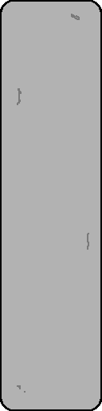

# Sprites

- ## [Student](Student)
    ### [Student Heads (Aseprite)](Student/Student_Heads.aseprite)
    

    ### [Student Faces (Aseprite)](Student/Student_Heads.aseprite)
    

    ### [Student Hats (Aseprite)](Student/Student_Hats.aseprite)
    

- ## [Seat](Seat)
    ### [Seat (Aseprite)](Seat/Seat.aseprite)
    

- ## [Table](Table)
    ### [Table (Aseprite)](Table/Table.aseprite)
    

- ## [Tiles](Tiles)
    ### [Tile Floor (Aseprite)](Tiles/Tile_Floor.aseprite)
    